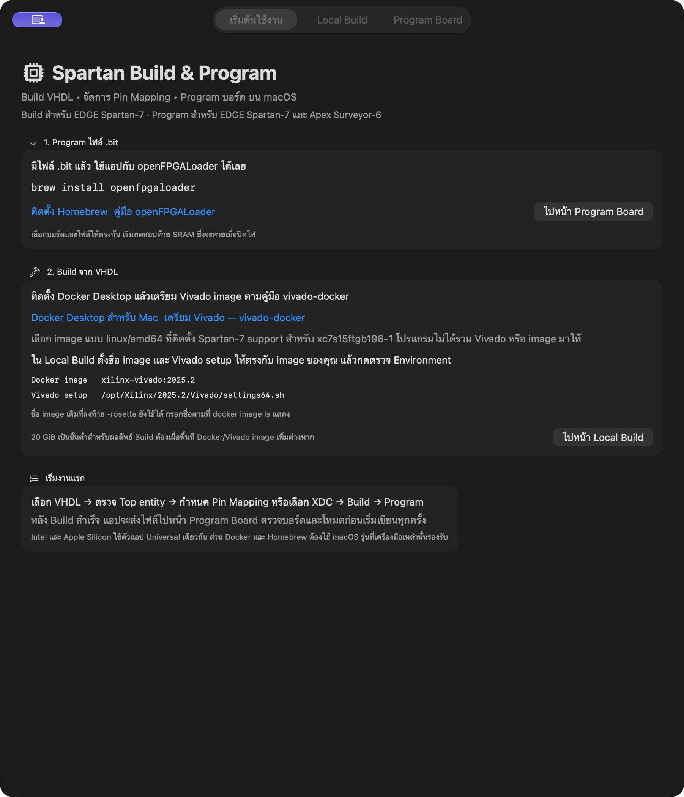

# Spartan Build & Program for macOS

แอป macOS สำหรับสร้างไฟล์ `.bit` จาก VHDL จัดการ Pin Mapping และ Program บอร์ด
Spartan ผ่าน USB/JTAG ใช้ Vivado ใน Docker สำหรับ Build และ openFPGALoader สำหรับ
Program บอร์ด



## ดาวน์โหลดและเริ่มใช้

ดาวน์โหลดจาก [Releases](https://github.com/Telnwza/Mac-Spartan-Build-Program/releases/tag/v2.4.0):

- [แอปพร้อมคู่มือและตัวอย่าง](https://github.com/Telnwza/Mac-Spartan-Build-Program/releases/download/v2.4.0/Spartan-Build-Program-macOS-2.4.0-with-guide.zip)
- [เฉพาะแอป](https://github.com/Telnwza/Mac-Spartan-Build-Program/releases/download/v2.4.0/Spartan-Build-Program-macOS-2.4.0.zip)
- [SHA-256 checksums](https://github.com/Telnwza/Mac-Spartan-Build-Program/releases/download/v2.4.0/SHA256SUMS.txt)

แตก ZIP แล้วลาก `Spartan Build & Program.app` ไปไว้ใน Applications
ผู้ใช้แอปสำเร็จรูปไม่ต้องติดตั้ง Xcode

หาก macOS บล็อกแอป ให้ดู [วิธีเปิดแอปและติดตั้ง](INSTALL_MANUAL_TH.md#เปิดแอปครั้งแรก)
ชุดแจก 2.4.0 ล่าสุดเซ็นด้วย Developer ID และผ่าน Apple notarization แล้ว
ดูรายละเอียดใน [release notes](docs/RELEASE_NOTES_2.4.0.md)

## รองรับอะไรบ้าง

| งาน | บอร์ด |
|---|---|
| Build VHDL → `.bit` และ Pin Mapping | EDGE Spartan-7 `xc7s15ftgb196-1` |
| Program SRAM, Program/Verify SPI Flash, Clear Flash | EDGE Spartan-7 และ Apex Surveyor-6 |

ตัวแอปเป็น Universal Binary สำหรับ Apple Silicon และ Intel ตั้งเป้า macOS 13 ขึ้นไป
หากใช้ Docker หรือ Homebrew ต้องใช้ macOS รุ่นที่เครื่องมือเหล่านั้นรองรับด้วย
ดู [สถานะการทดสอบและข้อจำกัด](docs/TESTING.md) ก่อนเลือกใช้กับเครื่องของคุณ

## สิ่งที่ต้องติดตั้ง

| ต้องการทำอะไร | เครื่องมือที่ต้องมี |
|---|---|
| Program ไฟล์ `.bit` ที่มีอยู่แล้ว | [Homebrew](https://brew.sh) และ [openFPGALoader](https://trabucayre.github.io/openFPGALoader/guide/install.html#macos) |
| สร้าง `.bit` จาก VHDL | เพิ่ม [Docker Desktop](https://docs.docker.com/desktop/setup/install/mac-install/) และ Vivado image |

ติดตั้งเครื่องมือ Program ด้วยคำสั่ง:

```sh
brew install openfpgaloader
```

สำหรับ Vivado ให้ทำตาม [filmil/vivado-docker](https://github.com/filmil/vivado-docker)
เพื่อสร้าง image จาก AMD installer ของคุณเอง เลือก Vivado 2025.2, platform
`linux/amd64` และติดตั้ง **Spartan-7 support**
แอปนี้ไม่ได้รวม Vivado, AMD installer หรือ Docker image มาให้

## ตั้งค่าแอป

1. เปิดแท็บ **เริ่มต้นใช้งาน** เพื่อดูลิงก์ติดตั้งเครื่องมือ
2. หากจะ Program อย่างเดียว ไปที่ **Program Board** ตรวจว่าพบ openFPGALoader
   แล้วเลือกบอร์ดและไฟล์ `.bit`
3. หากจะ Build ให้เปิด Docker Desktop แล้วไปที่ **Local Build** ตั้งค่าดังนี้:

   | ค่า | ค่าเริ่มต้น |
   |---|---|
   | Docker image | `xilinx-vivado:2025.2` |
   | Vivado setup ภายใน container | `/opt/Xilinx/2025.2/Vivado/settings64.sh` |
   | ผลลัพธ์ Build | `~/Documents/FPGA-Builds/SpartanProgrammer` |
   | พื้นที่ว่างขั้นต่ำสำหรับผลลัพธ์ | 20 GiB |

4. กรอกชื่อ image ตามผล `docker image ls` แล้วกด **ตรวจ Environment**
   หากคุณใช้ image เดิมชื่อ `xilinx-vivado:2025.2-rosetta` ให้ใช้ชื่อนั้นต่อได้
5. เลือก VHDL → ตรวจ Top entity → กำหนด Pin Mapping หรือเลือก XDC → **Build .bit บน Mac**
6. เมื่อ Build ผ่าน แอปจะส่งไฟล์ไปหน้า Program Board ให้ตรวจบอร์ดและโหมดก่อน Program

พื้นที่ Docker/Vivado image ต้องเตรียมเพิ่มจากพื้นที่ผลลัพธ์ Build
รายละเอียดการเชื่อม image กับแอปอยู่ใน [คู่มือติดตั้ง](INSTALL_MANUAL_TH.md)

## เอกสาร

- [ติดตั้งและใช้งานครั้งแรก](INSTALL_MANUAL_TH.md)
- [คำถามและปัญหาที่พบบ่อย](docs/FAQ.md)
- [Build ตัวแอปจาก source และรันทดสอบ](docs/DEVELOPMENT.md)
- [เตรียม GitHub repository และ release](docs/RELEASING.md)
- [Release notes 2.4.0](docs/RELEASE_NOTES_2.4.0.md)
- [สถานะการทดสอบ](docs/TESTING.md)

## License และโครงการที่เกี่ยวข้อง

[MIT License](LICENSE) · Copyright © 2026 techin

แอปเรียกใช้ [vivado-docker](https://github.com/filmil/vivado-docker) และ
[openFPGALoader](https://github.com/trabucayre/openFPGALoader) ซึ่งติดตั้งแยกต่างหาก
ดู [Third-party notices](THIRD_PARTY_NOTICES.md)
